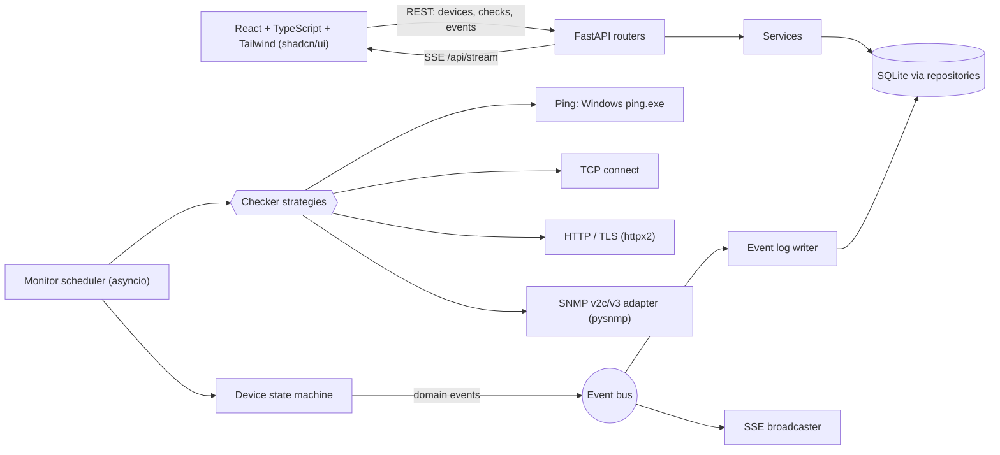

# NetPulse

A small, single-user web app that watches the devices you depend on while you work
through Windows Server / Active Directory procedures (promoting or demoting a domain
controller, rebooting hosts, moving DNS/DHCP, changing VLANs). You add devices by hand
(name + IP or hostname), pick what to check, and NetPulse polls them continuously and
pushes every change to a live dashboard and an event log, with a browser notification,
a beep and a flashing tab title when something drops, degrades or reboots.

**Relation to Zabbix.** NetPulse does not replace Zabbix, the long-term operations
monitor planned for the AD project. It is a lightweight companion for the duration of a
procedure: set up in a minute, no agents, no templates.

## What it checks

- **Liveness:** ICMP ping (default) or a chosen TCP port, for hosts whose firewall drops ICMP.
- **TCP port checks:** any number of ports, plus a one-click *Domain Controller* preset
  (53, 88, 135, 389, 445, 636, 3268, 3389).
- **SNMP v2c or v3, per device (optional):** uptime (reboot detection), interface
  operational status, custom OIDs (alert on change or on threshold).
- **Website / API monitoring:** add a device of kind *Website / API* with a URL. Its
  liveness is an HTTP request to that URL (30 s interval and 10 s timeout by default).
  You can also add HTTP checks to any device. An HTTP check can assert:
  - the expected status (default `200-399`);
  - response time: slower than 2000 ms (default) marks the device `DEGRADED`;
  - a keyword that must be present or absent in the body;
  - a value in a JSON response (for example `data.status == ok`);
  - certificate expiry: a warning event at 14 days or fewer (default), a critical event
    when it has expired, an info event once it is renewed.

  Full API checks are supported: method, headers, body, and bearer, basic or header auth.
- **Statuses:** `UNKNOWN`, `UP`, `DEGRADED` (liveness fine, another check failing),
  `DOWN` (liveness failed `fail_threshold` times in a row), `PAUSED`.
  Defaults: poll every 5 s, `DOWN` after 2 consecutive failures, 1000 ms timeout.
- **Event log:** persistent, with filter, acknowledge and clear. Events are written only
  when something changes, never on every poll. Restarting NetPulse does not log devices
  again unless their status differs from before the restart. Info events (a device coming
  up, a pause) arrive already acknowledged; only warnings and critical events wait for **Ack**.
- **Status history:** every status change is kept for 30 days and drawn on the dashboard
  (see below).

Out of scope for v1: login, multiple users, running as a Windows service, email/chat
alerts, SNMP traps, auto-discovery, topology maps, long-term metric history (only the
last 60 latency samples per device, in memory; status changes are kept for 30 days, see
*Status history*).

## Architecture



Backend: FastAPI + an asyncio scheduler (one task per device) + SQLite. REST for CRUD,
Server-Sent Events for live push. Frontend: React with TypeScript, Tailwind CSS and
shadcn/ui components, built once into `web/dist` and served
by the backend itself, so a normal run needs only one process.

## Requirements

- Windows 10/11 (the ping checker parses the output of Windows `ping.exe`).
- **Python 3.12 or newer** on PATH (the `py` launcher or `python`).
- **Node.js 22 LTS** (20.19+ minimum to build), only once, to build the web UI the first
  time (or when you change the frontend). Not needed afterwards.
- No admin rights needed.

## Start and stop

Double-click **`run.bat`**. On the first run it creates `backend\.venv`, installs the
Python dependencies, builds the UI (`npm ci`, `npm run build`), then starts the server and
opens <http://localhost:8765> (or the port in `NETPULSE_PORT`). If the browser opens before
the server is ready, refresh. If the dependency install fails (for example no internet),
fix the cause and run `run.bat` again: it retries the install until one succeeds.

To stop, press `Ctrl+C` in the console window or close it.

Manual start, from the repository root:

```bat
cd backend
.venv\Scripts\python -m app
```

### Settings (environment variables)

| Variable | Default | Meaning |
|---|---|---|
| `NETPULSE_HOST` | `127.0.0.1` | Address to bind. |
| `NETPULSE_PORT` | `8765` | Port to listen on. |
| `NETPULSE_DATA_DIR` | `<repo>/data` | Folder for the database and key. |
| `NETPULSE_ALLOWED_HOSTS` | (empty) | Extra host names, comma separated, the server answers to when `NETPULSE_HOST` is not a loopback address (for example `netpulse.corp.local`). |

> **Warning:** NetPulse has no login. Keep `NETPULSE_HOST` at `127.0.0.1`. Binding to
> `0.0.0.0` or a LAN address lets anyone who can reach the port read your device list,
> change checks and clear the log.

The server only answers requests whose `Host` header is `localhost`, `127.0.0.1` or
`[::1]` (plus, when bound beyond loopback, the bind address and `NETPULSE_ALLOWED_HOSTS`);
anything else gets `400`. This stops a malicious web page from reaching the API through
DNS rebinding. Writes (`POST`/`PUT`/`DELETE`) that carry an `Origin` header from any other
site get `403`.

### Dev mode

Run the backend and the Vite dev server side by side (Vite proxies `/api` to the backend):

```sh
# terminal 1
cd backend && .venv/bin/python -m app          # Windows: .venv\Scripts\python -m app
# terminal 2
cd web && npm install && npm run dev
```

Tests: `cd backend && .venv/bin/pytest` and `cd web && npm test`.
Frontend checks, from `web/`: `npm run lint` (Oxlint) and `npm run typecheck` (TypeScript).
`npm run gen:api` regenerates `src/api/schema.d.ts` from the backend's OpenAPI schema.
It needs `backend/.venv`, and network access on the first run, because it fetches
pinned `typescript@5.9.3` and `openapi-typescript@7.13.0` through `npx`. Run it after you
change an API model and commit the result: the frontend test fails if the committed
file is stale.
CPU budget check (no network used): `cd backend && .venv/bin/python scripts/perf_check.py`.

## Using it

1. Click **Add device**, enter a name and an IP or hostname. Leave liveness on *ping*, or
   choose *TCP port* for hosts that block ICMP.
2. For a domain controller, use the **Domain Controller preset** on the Ports tab: it adds
   the checks for 53, 88, 135, 389, 445, 636, 3268 and 3389 in one click. If LDAP (389)
   stops while ping still answers, the card turns `DEGRADED` and the log names the port.
3. For SNMP, open the SNMP tab, pick v2c or v3 and tick what to watch (uptime/reboot,
   interfaces, custom OIDs).
4. To watch a website or API, click **Add device**, choose kind *Website / API* and enter
   the URL. Open the HTTP tab to add checks (status, keyword, JSON value, certificate
   days, auth). **Test** on an HTTP check works after the device is saved.
5. Allow browser notifications when asked. Use *Pause* to silence a device during planned
   work and *Test now* to run its checks immediately.

## Dashboard

The top of the page is a status panel:

- a **headline** with the overall state and how many devices are down or degraded (or that all are up);
- **problems in the last hour**, as a count;
- a **timeline chart** of problems over time and a **status strip** with one slot per
  time bucket, coloured by the worst status in it;
- a range switch: **1h**, **24h** or **7d**.

Below it, the devices come in two views, chosen with the toggle in the toolbar:

- **List** (compact rows) and **Cards** (the original grid).
- **Search** matches name, IP or host, kind, status, notes and port numbers, so typing
  `389` finds every device with an LDAP check.
- **Sort** by *Problems first*, *Name*, *Host* or *Latency*.
- In the list, click a row to expand it: a history bar for the chosen range, the uptime
  percentage, the port checks and a **Details** button that opens the full device view.

The **theme toggle** in the top bar switches between light and dark.

### Status history

Status changes are stored for 30 days in their own table, separate from the event log:
clearing the event log does not erase the history. Periods when NetPulse itself was
stopped cleanly are shown as *no data*, not as up or down. If NetPulse crashes (power
loss, killed process), it cannot record that it stopped, so the gap is drawn with the
last known status of each device.

API: `GET /api/history?range=1h|24h|7d` returns the history for all devices in that range.

## Windows notes

### Firewall and ping

Windows Server blocks inbound ICMP echo by default, which makes a healthy server look
`DOWN`. Either allow echo on the target (elevated PowerShell on that server):

```powershell
Enable-NetFirewallRule -Name FPS-ICMP4-ERQ-In
```

or set the device's liveness to **TCP port** (for example 445 or 3389) instead of ping.

### SNMP on Windows Server

SNMP is an optional, deprecated feature and is usually not installed. On the target:

```powershell
Install-WindowsFeature SNMP-Service -IncludeManagementTools
```

Then open **Services > SNMP Service > Properties > Security**: add a community with read
only rights and add the NetPulse PC under *Accept SNMP packets from these hosts*. On
network gear prefer **SNMP v3 with authPriv**; v2c sends the community in clear text.

### HTTPS, internal CAs and proxies

- Certificates are verified against the Windows certificate store. A site signed by your
  domain CA therefore verifies on a domain-joined PC without skipping verification.
- Switching **Verify TLS** off on a check only skips verification. NetPulse still reads
  the certificate expiry.
- `HTTP_PROXY`, `HTTPS_PROXY` and `NO_PROXY` are honoured.

## Data, backup and reset

`data/` (or `NETPULSE_DATA_DIR`) holds:

- `netpulse.db`: devices, checks, the event log and 30 days of status history.
- `secret.key`: encrypts the SNMP secrets and the HTTP auth secrets in the database.
  HTTP headers are stored unencrypted: put tokens in *Auth*, not in headers.

Back them up **together**. If you lose `secret.key`, a new key is made on the next start
and the stored SNMP communities and keys can no longer be read: NetPulse still starts,
logs a warning, shows those secrets as not set, and you must re-enter them. The key sits beside the database, so the PC
itself is the trust boundary: do not copy `data/` to shared locations. Secrets are
write-only through the API and never logged.

On start, NetPulse adds any new columns to an older `netpulse.db` automatically and keeps
your devices, checks, events and history. Back up `data/` before upgrading.

**Reset:** stop NetPulse, delete the `data/` folder, start again. This removes all
devices, history and the key.

## Troubleshooting

- **Everything is `DOWN`:** check the admin PC itself first (network cable, VPN, correct
  VLAN). If only ping-based devices are down, see the firewall note above.
- **A device is `DEGRADED`:** open its detail and read the log message; it names the
  failing check (a port, an SNMP query).
- **SNMP checks fail with `timeout`:** the SNMP service is not running, the community or
  v3 credentials are wrong, or the NetPulse PC is not in the allowed hosts list.
- **Port already in use:** set `NETPULSE_PORT` to another value.
- **`run.bat` says Node.js is needed:** install Node 22 LTS (20.19+) once to build the UI.
- **`400 Invalid host header`:** you opened NetPulse by a name it does not know. Use
  `http://localhost:8765`, or add the name to `NETPULSE_ALLOWED_HOSTS` when bound to a LAN
  address.

## Security

Single user on localhost, so there is no authentication. The server binds to `127.0.0.1`
by default. SNMP and HTTP auth secrets are encrypted at rest (Fernet) and never returned by the API or
written to logs; HTTP auth secrets are write-only in the same way. Prefer SNMP v3 authPriv over v2c.

## Known risks

| # | Risk | Mitigation |
|---|---|---|
| R1 | ICMP blocked by Windows Firewall on servers gives a false `DOWN`. | `liveness = TCP port` option; firewall rule above. |
| R2 | The SNMP feature is not installed on Windows Server. | SNMP is per device and optional; install steps above. |
| R14 | Internal certificates are not trusted, so HTTPS checks fail with a TLS error. | Verification uses the Windows certificate store; per-check *Verify TLS* switch. |

## First-run checklist on Windows

These checks need a real Windows PC and a real LAN, so they are not covered by the
automated tests. Run them once before relying on NetPulse:

- [ ] `run.bat` on a clean checkout: creates the venv, builds the UI, opens the browser.
      Run it again: it starts straight away.
- [ ] `run.bat` with Python missing from PATH shows a clear message and pauses.
- [ ] Add a LAN host with ping liveness: card goes `UP` and latency looks plausible
      (validates `ping.exe` output parsing, including a localised Windows).
- [ ] Unplug or firewall that host: `DOWN` and the alert appear within about 12 s at the
      defaults (interval x threshold + 2 s); `UP` again within one interval of recovery.
- [ ] Add a domain controller with the preset (under a minute); stop LDAP or block 389:
      the card shows `DEGRADED` and the log names the port.
- [ ] SNMP against a real Windows Server and a network device: uptime, interface and OID
      values appear; reboot the Windows host and see a `reboot` event.
- [ ] Browser notification, beep and flashing tab title fire on a `DOWN` event.
- [ ] CPU under 5 % with 50 ping devices.
- [ ] A switch with 50+ interfaces: the interfaces check finishes under the timeout (no
      `interfaces timeout` and no `DEGRADED` from it).
- [ ] Two SNMPv3 devices sharing a username with different keys both answer.
- [ ] A public HTTPS site shows `UP` with a response time and certificate days.
- [ ] An internal HTTPS site signed by the domain CA verifies without skipping verification.
- [ ] An API check with a bearer token passes, and the token never appears in the UI or
      the event log.
- [ ] A wrong keyword turns the device `DEGRADED`.
- [ ] Upgrading with an existing `data/` keeps all devices, checks, events and history.
- [ ] `npm test` in `web/` passes (the schema drift test needs network once, for `npx`).
