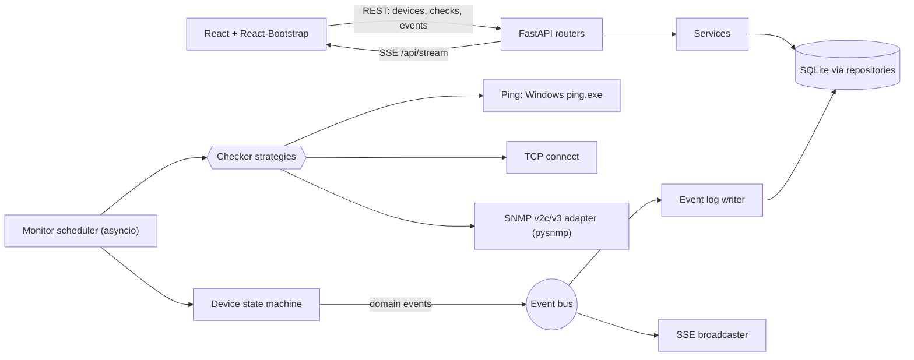

# NetPulse

A small, single-user web app that watches the devices you depend on while you work
through Windows Server / Active Directory procedures (promoting or demoting a domain
controller, rebooting hosts, moving DNS/DHCP, changing VLANs). You add devices by hand
(name + IP or hostname), pick what to check, and NetPulse polls them continuously and
pushes every change to a live dashboard and an event log, with a browser notification,
a beep and a flashing tab title when something drops, degrades or reboots.

**Relation to Zabbix.** NetPulse does not replace Zabbix, the long-term operations
monitor planned for the AD project. It is a lightweight companion for the duration of a
procedure: set up in a minute, no agents, no templates.

## What it checks

- **Liveness:** ICMP ping (default) or a chosen TCP port, for hosts whose firewall drops ICMP.
- **TCP port checks:** any number of ports, plus a one-click *Domain Controller* preset
  (53, 88, 135, 389, 445, 636, 3268, 3389).
- **SNMP v2c or v3, per device (optional):** uptime (reboot detection), interface
  operational status, custom OIDs (alert on change or on threshold).
- **Statuses:** `UNKNOWN`, `UP`, `DEGRADED` (liveness fine, another check failing),
  `DOWN` (liveness failed `fail_threshold` times in a row), `PAUSED`.
  Defaults: poll every 5 s, `DOWN` after 2 consecutive failures, 1000 ms timeout.
- **Event log:** persistent, with filter, acknowledge and clear. Events are written only
  when something changes, never on every poll.

Out of scope for v1: login, multiple users, running as a Windows service, email/chat
alerts, SNMP traps, auto-discovery, topology maps, long-term metric history (only the
last 60 latency samples per device, in memory).

## Architecture



Backend: FastAPI + an asyncio scheduler (one task per device) + SQLite. REST for CRUD,
Server-Sent Events for live push. Frontend: React, built once into `web/dist` and served
by the backend itself, so a normal run needs only one process.

## Requirements

- Windows 10/11 (the ping checker parses the output of Windows `ping.exe`).
- **Python 3.12 or newer** on PATH (the `py` launcher or `python`).
- **Node.js 20 or newer**, only once, to build the web UI the first time (or when you
  change the frontend). Not needed afterwards.
- No admin rights needed.

## Start and stop

Double-click **`run.bat`**. On the first run it creates `backend\.venv`, installs the
Python dependencies, builds the UI (`npm ci`, `npm run build`), then starts the server and
opens <http://localhost:8765>. If the browser opens before the server is ready, refresh.

To stop, press `Ctrl+C` in the console window or close it.

Manual start, from the repository root:

```bat
cd backend
.venv\Scripts\python -m app
```

### Settings (environment variables)

| Variable | Default | Meaning |
|---|---|---|
| `NETPULSE_HOST` | `127.0.0.1` | Address to bind. |
| `NETPULSE_PORT` | `8765` | Port to listen on. |
| `NETPULSE_DATA_DIR` | `<repo>/data` | Folder for the database and key. |

> **Warning:** NetPulse has no login. Keep `NETPULSE_HOST` at `127.0.0.1`. Binding to
> `0.0.0.0` or a LAN address lets anyone who can reach the port read your device list,
> change checks and clear the log.

### Dev mode

Run the backend and the Vite dev server side by side (Vite proxies `/api` to the backend):

```sh
# terminal 1
cd backend && .venv/bin/python -m app          # Windows: .venv\Scripts\python -m app
# terminal 2
cd web && npm install && npm run dev
```

Tests: `cd backend && .venv/bin/pytest` and `cd web && npm test`.
CPU budget check (no network used): `cd backend && .venv/bin/python scripts/perf_check.py`.

## Using it

1. Click **Add device**, enter a name and an IP or hostname. Leave liveness on *ping*, or
   choose *TCP port* for hosts that block ICMP.
2. For a domain controller, use the **Domain Controller preset** on the Ports tab: it adds
   the checks for 53, 88, 135, 389, 445, 636, 3268 and 3389 in one click. If LDAP (389)
   stops while ping still answers, the card turns `DEGRADED` and the log names the port.
3. For SNMP, open the SNMP tab, pick v2c or v3 and tick what to watch (uptime/reboot,
   interfaces, custom OIDs).
4. Allow browser notifications when asked. Use *Pause* to silence a device during planned
   work and *Test now* to run its checks immediately.

## Windows notes

### Firewall and ping

Windows Server blocks inbound ICMP echo by default, which makes a healthy server look
`DOWN`. Either allow echo on the target (elevated PowerShell on that server):

```powershell
Enable-NetFirewallRule -Name FPS-ICMP4-ERQ-In
```

or set the device's liveness to **TCP port** (for example 445 or 3389) instead of ping.

### SNMP on Windows Server

SNMP is an optional, deprecated feature and is usually not installed. On the target:

```powershell
Install-WindowsFeature SNMP-Service -IncludeManagementTools
```

Then open **Services > SNMP Service > Properties > Security**: add a community with read
only rights and add the NetPulse PC under *Accept SNMP packets from these hosts*. On
network gear prefer **SNMP v3 with authPriv**; v2c sends the community in clear text.

## Data, backup and reset

`data/` (or `NETPULSE_DATA_DIR`) holds:

- `netpulse.db`: devices, checks and the event log.
- `secret.key`: encrypts the SNMP secrets in the database.

Back them up **together**. If you lose `secret.key`, the stored SNMP communities and keys
cannot be read and you must re-enter them. The key sits beside the database, so the PC
itself is the trust boundary: do not copy `data/` to shared locations. Secrets are
write-only through the API and never logged.

There are no schema migrations in v1. If a release changes the schema, this README will
say so.

**Reset:** stop NetPulse, delete the `data/` folder, start again. This removes all
devices, history and the key.

## Troubleshooting

- **Everything is `DOWN`:** check the admin PC itself first (network cable, VPN, correct
  VLAN). If only ping-based devices are down, see the firewall note above.
- **A device is `DEGRADED`:** open its detail and read the log message; it names the
  failing check (a port, an SNMP query).
- **SNMP checks fail with `timeout`:** the SNMP service is not running, the community or
  v3 credentials are wrong, or the NetPulse PC is not in the allowed hosts list.
- **Port already in use:** set `NETPULSE_PORT` to another value.
- **`run.bat` says Node.js is needed:** install Node 20+ once to build the UI.

## Security

Single user on localhost, so there is no authentication. The server binds to `127.0.0.1`
by default. SNMP secrets are encrypted at rest (Fernet) and never returned by the API or
written to logs. Prefer SNMP v3 authPriv over v2c.

## Known risks

| # | Risk | Mitigation |
|---|---|---|
| R1 | ICMP blocked by Windows Firewall on servers gives a false `DOWN`. | `liveness = TCP port` option; firewall rule above. |
| R2 | The SNMP feature is not installed on Windows Server. | SNMP is per device and optional; install steps above. |

## First-run checklist on Windows

These checks need a real Windows PC and a real LAN, so they are not covered by the
automated tests. Run them once before relying on NetPulse:

- [ ] `run.bat` on a clean checkout: creates the venv, builds the UI, opens the browser.
      Run it again: it starts straight away.
- [ ] `run.bat` with Python missing from PATH shows a clear message and pauses.
- [ ] Add a LAN host with ping liveness: card goes `UP` and latency looks plausible
      (validates `ping.exe` output parsing, including a localised Windows).
- [ ] Unplug or firewall that host: `DOWN` and the alert appear within about 12 s at the
      defaults (interval x threshold + 2 s); `UP` again within one interval of recovery.
- [ ] Add a domain controller with the preset (under a minute); stop LDAP or block 389:
      the card shows `DEGRADED` and the log names the port.
- [ ] SNMP against a real Windows Server and a network device: uptime, interface and OID
      values appear; reboot the Windows host and see a `reboot` event.
- [ ] Browser notification, beep and flashing tab title fire on a `DOWN` event.
