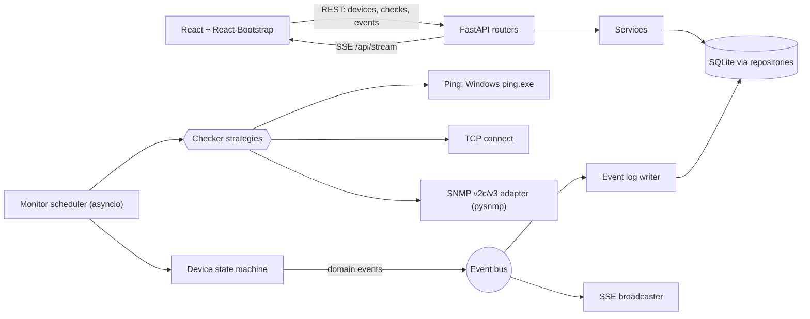

# NetPulse — Design Spec

Date: 2026-11-10 · Status: approved 2026-11-10 · Owner: Bajun
Mirrored in the vault as `01-Projects/NetPulse/02-design.md`; gates, ADRs, risks and the
sprint log live there.

## 1. Purpose

While working through Windows Server AD procedures (promoting or demoting a DC, rebooting
hosts, moving DNS/DHCP, changing VLANs), we need to see **at a glance, live** whether the
devices we depend on are still healthy, and be told the moment one drops, degrades or
reboots.

NetPulse is a small, single-user web app that runs on the admin PC. You add devices by
hand (name + IP/hostname), choose what to check on each, and it polls them continuously,
pushing every change to a dashboard and an event log.

**Relation to Zabbix.** The AD project plans Zabbix 7.0 LTS as the long-term operations
monitor. NetPulse does not replace it: it is a lightweight companion for the duration of a
procedure, set up in a minute, with no agents or templates.

## 2. Scope

### In scope (v1)
- Manual device management: add, edit, pause/resume, delete, "test now".
- Checks per device:
  - **Liveness**: ICMP ping (default) or a chosen TCP port (for hosts whose firewall drops ICMP).
  - **TCP port checks**: any number of ports; a one-click *Domain Controller* preset
    (53, 88, 135, 389, 445, 636, 3268, 3389).
  - **SNMP v2c or v3, per device**: uptime (reboot detection), interface oper status,
    custom OIDs (alert on change or on threshold).
- Device status: `UNKNOWN`, `UP`, `DEGRADED`, `DOWN`, `PAUSED`.
- Default poll every 5 s; `DOWN` after 2 consecutive liveness failures. Both per device.
- Live dashboard (status cards, latency trend, port chips, SNMP values).
- Persistent event log with filter, acknowledge and clear.
- Alerts: browser notification, generated beep, flashing tab title.
- Runs on one Windows 10/11 PC at `http://localhost:8765`, started by `run.bat`.

### Out of scope (v1)
- Login, multiple users, running as a Windows service, shared server deployment.
- Email/chat alerts, SNMP traps, auto-discovery, topology maps.
- Long-term metric history and graphs (only the last 60 latency samples, in memory).
- Procedure checklists or step tracking.
- Import/export of device lists (later brick).

### Success criteria
1. A device that stops answering is shown `DOWN` and alerts within **interval × threshold + 2 s**
   (≈ 12 s at defaults), and `UP` again within one interval of recovery.
2. A DC whose LDAP (389) stops while ping still works is shown `DEGRADED` and named in the log.
3. A reboot of an SNMP-enabled host is logged as `reboot` (sysUpTime went backwards).
4. Adding a DC with the preset takes under one minute.
5. Monitoring 50 devices at 5 s intervals keeps the backend under 5 % CPU on a normal PC.

## 3. Architecture

Approach chosen: **FastAPI + asyncio scheduler + SQLite, REST for CRUD, Server-Sent Events
for live push** (see ADR-001). Alternatives rejected: Flask + threads + client polling
(laggy, thread per check); API + Celery/Redis worker (too much to run on one PC).

### Layers (backend `app/`)
| Layer | Folder | Holds |
|---|---|---|
| API | `app/api/` | FastAPI routers, Pydantic request/response schemas, SSE endpoint |
| Services | `app/services/` | Device/check/event use cases; tells the scheduler when config changes |
| Domain | `app/domain/` | Entities, `DeviceStatus`, state machine, change detectors, event types. No I/O. |
| Monitoring | `app/monitoring/` | Scheduler, checker strategies, checker factory, SNMP adapter |
| Infrastructure | `app/infra/` | SQLite (SQLAlchemy) models and repositories, secret encryption, event bus |

Dependencies point inward: API → services → domain; monitoring and infra implement
interfaces the domain/services define.

### Design patterns (each tied to a real problem)
| Problem | Pattern | Where |
|---|---|---|
| Ping, TCP and SNMP checks must be interchangeable for the scheduler | **Strategy** (`Checker.check(target) -> CheckResult`) | `monitoring/checkers/` |
| Build the right checker from a stored check row | **Factory / registry** keyed by check type | `monitoring/factory.py` |
| UP/DEGRADED/DOWN with "N consecutive failures" | **State machine** (pure function `next_state(state, results, threshold)`) | `domain/state.py` |
| Persist, push and log changes without coupling them | **Observer** (in-process async event bus) | `infra/bus.py` |
| Hide pysnmp's API so it can be swapped or faked | **Adapter** (`SnmpClient` interface) | `monitoring/snmp.py` |
| Keep SQL out of services | **Repository** | `infra/repositories.py` |

### Monitoring loop
- One asyncio task per enabled device. On start, tasks are staggered by a random 0–1 s
  so devices aren't all checked in the same instant.
- Each cycle: run liveness first, then the device's other checks concurrently
  (`asyncio.gather`), each with its own timeout (`timeout_ms`, default 1000).
- Results feed the state machine and change detectors; any resulting domain events go to
  the bus. Latest results and the latency ring buffer (60 samples) live in an in-memory
  `StatusStore`.
- Editing, pausing or deleting a device restarts or cancels its task. No app restart needed.

### State rules
- Liveness failure count reaches `fail_threshold` → `DOWN`. Below threshold, the previous
  state holds (no flapping on a single lost ping).
- Liveness OK and every other enabled check OK → `UP`.
- Liveness OK but any other check failing → `DEGRADED` (message names the failing checks).
- Device disabled → `PAUSED`. New device before its first cycle → `UNKNOWN`.
- An event is emitted only on a **change** of state, never on every poll.

### Change detectors (SNMP)
- **Uptime**: current sysUpTime < previous → `reboot` event (critical).
- **Interfaces**: walk ifDescr + ifOperStatus; any interface changing status →
  `if_change` event (warning when going down, info when coming up). An optional ifIndex
  list limits which interfaces are watched.
- **Custom OID**: mode `change` → event when the value differs from the last poll;
  mode `threshold` → event when the value crosses `op value` (`>`, `>=`, `<`, `<=`, `==`, `!=`),
  and again when it returns.

## 4. Data model (SQLite, file `data/netpulse.db`)

| Table | Columns |
|---|---|
| `devices` | `id`, `name` (unique), `host`, `kind` (dc/server/switch/printer/other), `enabled`, `interval_s` (5), `fail_threshold` (2), `timeout_ms` (1000), `liveness` (`ping`/`tcp`), `liveness_port`, `snmp_version` (null/`v2c`/`v3`), `snmp_port` (161), `snmp_community_enc`, `snmp_user`, `snmp_auth_proto` (none/MD5/SHA/SHA256), `snmp_auth_key_enc`, `snmp_priv_proto` (none/DES/AES128/AES256), `snmp_priv_key_enc`, `notes`, `created_at`, `updated_at` |
| `checks` | `id`, `device_id` (FK, cascade delete), `type` (`tcp`/`snmp_uptime`/`snmp_if`/`snmp_oid`), `params` (JSON), `enabled`, `created_at` |
| `events` | `id`, `ts`, `device_id` (FK, set null), `check_id`, `severity` (info/warning/critical), `kind` (status_change/reboot/if_change/oid_change/oid_threshold/check_error), `message`, `status`, `previous_status` (both only for `status_change`), `acknowledged` |

`params` by type: `tcp` → `{port}`; `snmp_uptime` → `{}`; `snmp_if` → `{if_indexes?: [int]}`;
`snmp_oid` → `{oid, label, mode: "change"|"threshold", op?, value?}`.

Check health for state purposes: `snmp_uptime` and `snmp_oid` (change mode) are OK when the
device answers; `snmp_if` is OK when it answers and every listed `if_indexes` entry is up (without a
list, interface changes only raise events, since unused switch ports are normally down);
`snmp_oid` in threshold mode is OK while the threshold is not breached.

Secrets (`*_enc`) are encrypted with Fernet using a key generated on first run at
`data/secret.key`. The API accepts them but never returns them; responses carry
`has_community`, `has_auth_key`, `has_priv_key` flags instead.

## 5. REST API (`/api`)

| Method & path | Purpose |
|---|---|
| `GET /health` | Liveness of NetPulse itself |
| `GET /devices` · `POST /devices` | List, create (with optional inline `checks`) |
| `GET/PUT/DELETE /devices/{id}` | Read, update (incl. `enabled`), delete |
| `POST /devices/{id}/test` | Run all checks once now; returns results without changing state |
| `GET/POST /devices/{id}/checks` | List, add checks |
| `PUT/DELETE /checks/{id}` | Update, delete a check |
| `GET /status` | Snapshot: every device with state, since, latest results, latency trend |
| `GET /events?device_id=&severity=&limit=&before_id=` | Event log, newest first, paged |
| `POST /events/{id}/ack` · `DELETE /events` | Acknowledge one, clear all |
| `GET /stream` | SSE: `status`, `result`, `event` messages; heartbeat every 15 s |

Errors use FastAPI's standard shape: 404 for unknown ids, 409 for duplicate names, 422 for
validation errors.

## 6. Frontend (`web/`)

React 18 + Vite + React-Bootstrap (Bootstrap 5). Plain JavaScript (JSX), no Redux, no chart library.

- **Top bar**: name, stream indicator (live/reconnecting), *Add device*, sound toggle,
  *Enable notifications*.
- **Summary strip**: counts of Up / Degraded / Down / Paused.
- **Device grid**: one card per device. Border colour by state (green/yellow/red/grey),
  name, host, kind icon, latency + SVG sparkline, port chips (`389 ✓`), SNMP uptime,
  "DOWN for 1m 20s". Click → detail modal with checks, latest results, edit/pause/test/delete.
- **Event log panel**: newest at top, live; filter by device and severity; ack; clear.
- **Device form** (add/edit modal): General tab (name, host, kind, liveness, timing),
  Ports tab (list + DC preset), SNMP tab (off/v2c/v3 with matching fields; uptime and
  interface toggles; custom OID rows).
- **State**: `MonitorContext` holding a reducer fed by `/status` on load/reconnect and
  by SSE messages; `api.js` thin fetch wrapper.
- **Alerts**: on `DOWN`, `reboot`, recovery to `UP`, and critical threshold events:
  `Notification` (if permitted), Web Audio beep (if sound on, setting kept in
  localStorage), tab title `(n) DC01 DOWN` until the window is focused.

In production FastAPI serves the built `web/dist` on the same port; in development Vite
proxies `/api` to `localhost:8765`.

## 7. Error handling

- A checker never raises into the scheduler: exceptions and timeouts become a failed
  `CheckResult` with a reason (`timeout`, `refused`, `dns`, `snmp: authError`, …).
- A crashing device task is logged, recorded as a `check_error` event and restarted after
  5 s; other devices are unaffected.
- **Ping on Windows**: `ping -n 1 -w <timeout> <host>`, success only if exit code 0 **and**
  output contains `TTL=` (a router's "Destination host unreachable" exits 0). Latency is
  parsed from `time=`/`time<`; if unparsable, measured wall time is used.
- Hostnames are resolved per cycle; DNS failure counts as a liveness failure with
  reason `dns`.
- Pydantic validation: host is an IP or RFC 1123 hostname; ports 1–65535; interval 2–3600 s;
  threshold 1–10; timeout 200–10000 ms and below the interval; OID is dotted numeric.
- SSE: the browser `EventSource` reconnects on its own; on reconnect the UI reloads
  `/status`. The server drops slow clients whose queue exceeds 1000 messages.
- Startup: if `data/` or the key file is missing they are created; if the DB schema is
  older, tables are created (no migrations in v1; schema changes add a note to the README).

## 8. Security

Single user on localhost, so no authentication; the server binds to `127.0.0.1` only by
default (a `NETPULSE_HOST` setting can change it, with a README warning). SNMP secrets are
encrypted at rest; the key sits beside the DB, so the PC itself is the trust boundary.
SNMP v3 with authPriv is recommended over v2c. No secrets in logs or API responses.

## 9. Testing

- **pytest**: state machine and change detectors (pure; most tests); each checker with
  faked subprocess/socket/SNMP client; ping output parsing with real Windows samples
  (success, timeout, unreachable, localised); repositories on a temp SQLite file; API via
  FastAPI `TestClient`; scheduler with fake checkers and a short interval.
- **Vitest**: the monitor reducer and the alert decision helper.
- **Manual smoke test** before release: a real host on the LAN, unplug/firewall it, check
  timing against success criteria 1–3.

## 10. Delivery (bricks)

Each brick is usable before the next starts.

| Brick | Delivers | Usable result |
|---|---|---|
| B1 | Backend core: devices CRUD, ping liveness, state machine, events, SSE, `/status` | Watch devices via API/`curl` |
| B2 | React dashboard: cards, live log, add/edit form (general tab) | Ping monitor in the browser |
| B3 | TCP port checks, DC preset, `liveness=tcp` | AD service monitoring, `DEGRADED` state |
| B4 | SNMP v2c/v3: uptime/reboot, interfaces, custom OIDs; secret encryption | Full check set |
| B5 | Notifications + beep + tab title, `run.bat`, README, G3/G4 checklists | v1.0 release |

## 11. Risks

| # | Risk | Impact | Likelihood | Mitigation |
|---|---|---|---|---|
| R1 | ICMP blocked by Windows Firewall on servers → false `DOWN` | M | H | `liveness=tcp` option; README notes the firewall rule |
| R2 | SNMP service not installed on Windows Server (optional, deprecated feature) | M | H | SNMP is per device and optional; README shows how to add the feature |
| R3 | pysnmp API changes between versions | M | M | Pin version; all use behind `SnmpClient` adapter |
| R4 | Localised Windows ping output breaks parsing | L | M | Rely on exit code + `TTL=`; fall back to wall-clock latency |
| R5 | SNMP secrets on local disk | M | L | Fernet encryption; bind to 127.0.0.1; PC is trust boundary |
| R6 | Scope creep toward a Zabbix clone | M | M | Out-of-scope list above; new ideas go to the backlog |

## 12. Tech stack

Python 3.12, FastAPI, Uvicorn, SQLAlchemy 2 (SQLite), Pydantic 2, pysnmp (lextudio 7.x,
asyncio), cryptography (Fernet), pytest + pytest-asyncio + httpx. Node 20+, React 18, Vite,
React-Bootstrap + Bootstrap 5, Vitest.
