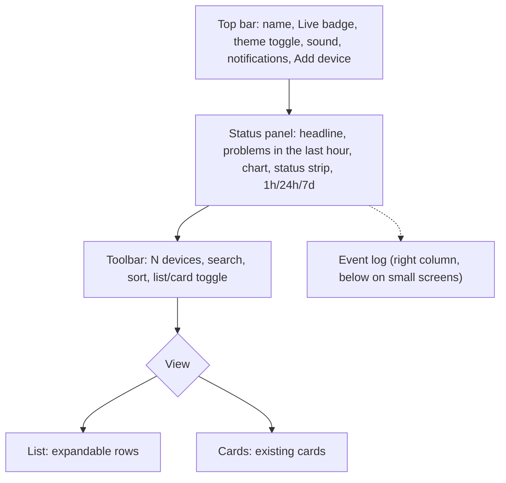

# NetPulse — Status panel, list/card views and status history (design addendum)

Date: 2026-11-11 · Status: approved 2026-11-11 · Owner: Bajun
Extends `2026-11-10-netpulse-design.md`. Mirrored in the vault as
`01-Projects/NetPulse/02-design addendum - Status panel and views.md`.

## 1. Purpose and scope change

Bajun wants the dashboard to read at a glance like a status page: one overall status panel
with a timeline (reference: an "is it down" status card with a spike chart and a coloured
status strip), and a device list that expands to show each device's history and uptime
(reference: a status-page monitor list with per-monitor history bars).

This needs **status history**, which v1 deliberately left out (spec §2 "Out of scope:
long-term metric history and graphs"). This addendum brings in a narrow slice of it:
status changes only, kept 30 days. Latency history, graphs per check, and reports stay
out of scope. Recorded as ADR-005.

### In scope
- Overall status panel above the devices: live headline, "N problems in the last hour",
  problems-over-time chart, status strip, range 1h / 24h / 7d (default 24h).
- Device list view (new default) with expandable rows: per-device status bar, uptime %,
  port chips, latency, SNMP uptime, "Details" opening the existing detail modal.
- Card view kept as today. A list/card toggle; shared search and sort for both views.
- Light/dark theme toggle (Bootstrap 5.3 colour modes), starting from the system setting.
- Backend: `status_history` table (30-day retention) and `GET /api/history`.

### Out of scope
- Latency or per-check history, charts per port, CSV/PDF reports, SLA targets.
- Recording history for time before this version is installed (bars fill in over time).
- Custom fonts: all text uses Bootstrap's default font stack (system UI font; monospace
  where the app already uses it for hosts/IPs).

### Success criteria
1. A device that goes DOWN for 5 minutes appears as red slots in its own bar and in the
   overall strip for the matching time, and the "problems in the last hour" count rises by 1.
2. Clearing the event log does not change any history bar or uptime %.
3. Search "389" in either view shows only devices with a port-389 check; sort "Problems
   first" puts DOWN, then DEGRADED, then UNKNOWN, then UP, then PAUSED.
4. The theme toggle switches every surface (panel, list, cards, modals, forms, event log)
   and the choice survives a reload.
5. `GET /api/history?range=7d` with 20 devices and 30 days of history answers in < 200 ms.

## 2. Backend

### 2.1 Data
New table `status_history` (SQLite, `sqlite_autoincrement`):

| Column | Type | Notes |
|---|---|---|
| `id` | int PK | never reused |
| `device_id` | int FK → devices.id, `ON DELETE CASCADE` | history goes with the device |
| `status` | str | `UNKNOWN`, `UP`, `DEGRADED`, `DOWN`, `PAUSED`, or `STOPPED` |
| `ts` | datetime (naive UTC, like other tables) | time of the change |

Index on `(device_id, ts)`.

- A `HistoryWriter` subscribes to the bus `"status"` topic (published on every status
  change, including the PAUSED→UNKNOWN reset) and appends one row per message. Writes go
  through the existing single-thread DB runner.
- On clean shutdown NetPulse appends `STOPPED` for every device, so time the app was not
  running shows as "no data" instead of the last status. After a crash the gap counts as
  the last known status (accepted limitation, noted in the README).
- Retention: rows older than 30 days are deleted at startup and then hourly; the newest row
  per device older than the cut-off is kept, so the status at the window start is known.
- The event log's "Clear" does not touch this table.

### 2.2 Bucketing (pure domain function, `app/domain/history.py`)
`bucketize(transitions, start, end, bucket_s, now) -> list[str | None]` for one device,
where `transitions` is the device's rows ordered by `ts`, including the last row before
`start`.

- The device's status over time is a step function: each row's status holds until the next
  row (or `now`).
- Each slot's value is the worst status present during the slot, ranked
  `DOWN > DEGRADED > UP`. If none of those is present, the slot is `PAUSED` when paused
  time is present, otherwise `None` (no data: before the first row, `STOPPED`, `UNKNOWN`).
- `uptime_pct(transitions, start, end, now) -> float | None` = time in `UP` ÷ time in
  `UP`, `DEGRADED` or `DOWN`, as a percentage rounded to 2 decimals; `None` when that
  denominator is 0. `PAUSED`, `STOPPED` and `UNKNOWN` count for neither.

Ranges:

| `range` | Window | Slots | Slot length |
|---|---|---|---|
| `1h` | 60 min | 60 | 1 min |
| `24h` | 24 h | 96 | 15 min |
| `7d` | 7 d | 84 | 2 h |

### 2.3 API
`GET /api/history?range=1h|24h|7d` (default `24h`; anything else → 422):

```json
{
  "range": "24h",
  "start": "2026-11-10T05:00:00+00:00",
  "end": "2026-11-11T05:00:00+00:00",
  "bucket_seconds": 900,
  "problems_last_hour": 5,
  "overall": {
    "problems": [0, 0, 1, 2, 0, "..."],
    "status": ["UP", "UP", "DEGRADED", "DOWN", null, "..."]
  },
  "devices": [
    {"device_id": 3, "buckets": ["UP", "DOWN", null, "..."], "uptime_pct": 98.61}
  ]
}
```

- `overall.problems[i]` = number of devices whose slot `i` is `DOWN` or `DEGRADED`.
- `overall.status[i]` = worst slot `i` across devices (same ranking), `PAUSED` if all
  present devices are paused, `None` if no device has data.
- `problems_last_hour` = number of rows in the last 60 minutes whose status is `DOWN` or
  `DEGRADED` and differs from the device's previous row (entries into a problem state).
- `start`/`end`: `end` = now rounded **up** to the slot length; `start` = `end` minus the
  window, so slots align to clock boundaries and the strip doesn't jitter between polls.
- Only current devices appear. One query per request for all rows in the window plus one
  for the last row before `start` per device.

## 3. Frontend

### 3.1 Layout


### 3.2 Status panel (`StatusPanel.jsx`)
- Headline from live state: "All N devices up" (green check), "N devices down" (red),
  "N devices degraded" (amber) — down wins over degraded; "No devices yet" when empty;
  paused devices are excluded from "all up".
- Sub-line: "N problems in the last hour" from the history response.
- Chart (`ProblemsChart.jsx`, inline SVG, no chart library): area/line of
  `overall.problems`, y from 0 to max(1, max value); x axis labels at 5 evenly spaced
  points ("24h ago" … "Now"; for 1h, minutes).
- Status strip (`StatusStrip.jsx`, reused for device bars): one block per slot; colours
  UP green, DEGRADED amber, DOWN red, PAUSED and no data grey; each block has a `title`
  with its time range and status for hover.
- Range buttons 1h / 24h / 7d (ButtonGroup); choice remembered in localStorage.
- Styling uses only Bootstrap's default theme colours (its CSS variables), so it follows
  the light/dark toggle with no custom hex values:
  - Panel background: `linear-gradient(135deg, var(--bs-primary-bg-subtle),
    var(--bs-success-bg-subtle))` with a `var(--bs-border-color)` border. In dark mode
    these are Bootstrap's deep navy and deep green (the reference's blue-to-green look);
    in light mode they are pale blue and pale green tints.
  - Text: headline `var(--bs-emphasis-color)`, sub-line and axis labels
    `var(--bs-secondary-color)`.
  - Chart: line `var(--bs-success)`, area fill `var(--bs-success)` at 25 % opacity.
  - Strip, bars and pills: `--bs-success` (UP), `--bs-warning` (DEGRADED), `--bs-danger`
    (DOWN), `--bs-secondary-bg` / `--bs-secondary` (paused, no data); headline icon uses
    the matching `text-success` / `text-warning` / `text-danger` utility.
- Bootstrap default font throughout; the headline is larger and bold (`fs-2 fw-bold`),
  not a different typeface.

### 3.3 Toolbar and views
- Toolbar: "N devices" (or "Showing X of N"), search input, sort select, list/card
  toggle (icon buttons with labels for screen readers). View and sort remembered in
  localStorage; search is not.
- Search (case-insensitive, trimmed): name, host, kind label, status, notes, TCP port
  numbers. Empty → all devices.
- Sort options: Problems first (default; DOWN, DEGRADED, UNKNOWN, UP, PAUSED, then name),
  Name, Host (IPv4 numeric order; hostnames after IPs, alphabetical), Latency (latest
  sample, missing last).
- Pure helpers in `deviceView.js`: `filterDevices(devices, query)`,
  `sortDevices(devices, sortKey)`, `compareHosts(a, b)`, `SORT_OPTIONS`.

### 3.4 List view (`DeviceList.jsx`, `DeviceRow.jsx`)
- Collapsed row: chevron, kind icon (inline SVG per kind: DC, server, switch, printer,
  other), name, second line (first failing check as "DEGRADED: tcp/389 refused" /
  "DOWN (ping: timeout)", else the host in monospace), status pill (icon + word).
- Click or Enter/Space toggles expansion; several rows may be open; expanded ids kept in
  component state only.
- Expanded: legend (Up, Degraded, Down, Paused / no data), the device's `StatusStrip`,
  "range ago … X% uptime … Now", port chips (shared `PortChips.jsx`, also used by
  `DeviceCard`), latency, SNMP uptime, and a "Details" button opening the existing
  `DeviceDetail` modal.
- A device with no history row yet shows an all-grey bar and "No history yet".

### 3.5 Theme
- `data-bs-theme` on `<html>`, `"light"` or `"dark"`; initial value from localStorage,
  else `prefers-color-scheme`. Toggle (sun/moon icon) in the top bar.
- Existing components already use Bootstrap variables/utilities; any hard-coded light
  colours found during the build are replaced with theme-aware ones.

### 3.6 Data flow
- `useHistory(range)`: fetches `/api/history` on mount, on range change, every 60 s, and
  after `reload()` (device add/edit/delete); keeps the last good response on error and
  shows a small "History unavailable" note in the panel.
- Live state (headline, pills, chips, latency) keeps coming from the existing SSE stream.

## 4. Testing
- **pytest**: `bucketize` and `uptime_pct` (status holding across slots, worst-in-slot,
  window starting mid-status, PAUSED/STOPPED/UNKNOWN as no data, no rows, rounding);
  `HistoryWriter` appends on "status"; retention keeps the newest pre-cut-off row;
  STOPPED written on shutdown; `/api/history` shape, range validation, slot alignment,
  `problems_last_hour`, event-log Clear leaves history intact, device delete cascades;
  a timing test for success criterion 5.
- **Vitest**: `filterDevices`, `sortDevices`, `compareHosts`, headline text helper,
  slot-label helper.
- **Browser check**: both themes × both views, expand/collapse, search, sort, range
  switch, a device going DOWN showing up in its bar and the strip, phone width.

## 5. Risks
| # | Risk | Mitigation |
|---|---|---|
| R7 | Scope creep toward a full status-page/SLA product | Scope list above; only status changes are stored |
| R8 | History table growth | 30-day retention; one row per status change, not per poll |
| R9 | Crash leaves a gap counted as the last status | STOPPED on clean shutdown; README notes the crash case |
| R10 | Hard-coded light colours break dark mode | Browser check of every surface in dark mode before merge |
